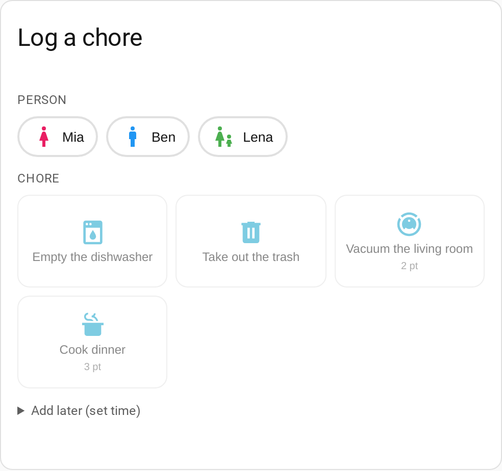
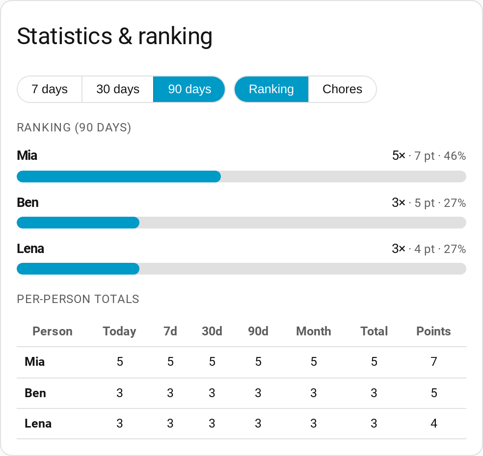
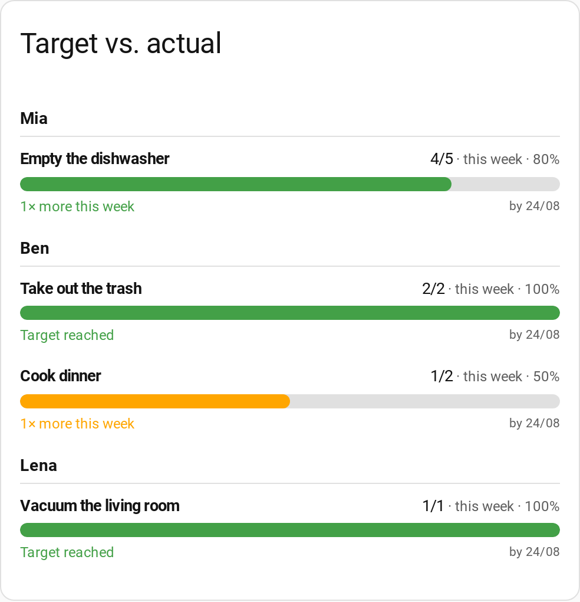
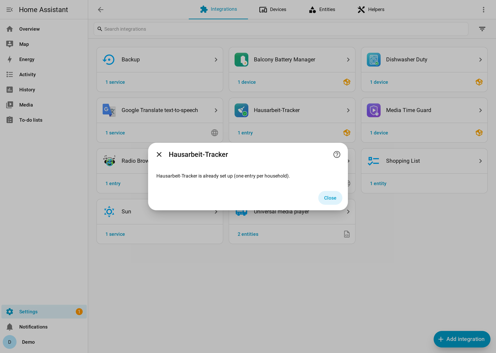
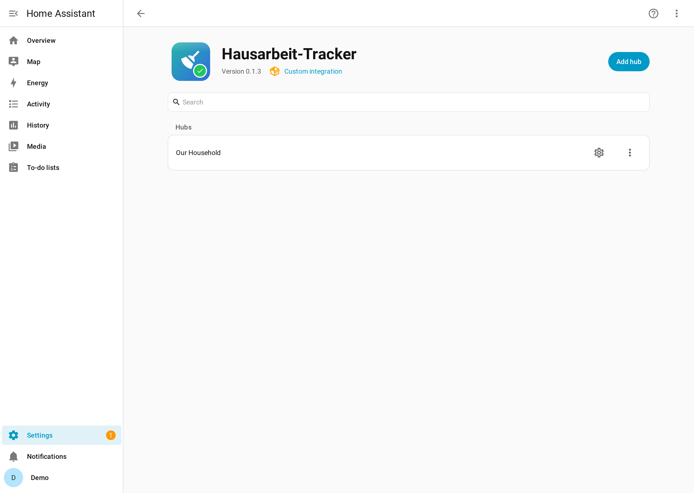
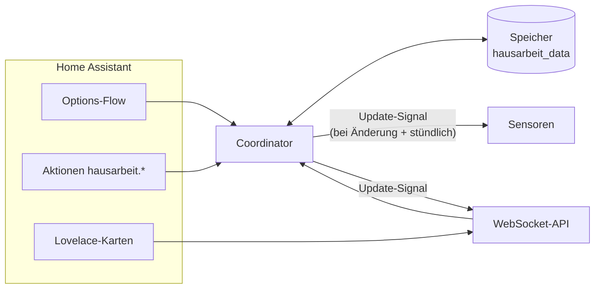

> 🇬🇧 [English](README.md) · 🇩🇪 Deutsch (diese Seite) · 🇪🇸 Español (nur Oberfläche)

<p align="center">
  
</p>

# Hausarbeit-Tracker

[](https://github.com/hacs/integration)
[](https://github.com/Jo-Highness/hausarbeit/actions/workflows/validate.yml)
[](https://github.com/Jo-Highness/hausarbeit/actions/workflows/test.yml)
[](./LICENSE)
[](https://www.home-assistant.io/)

**Halte fest, wer wann welche Hausarbeit erledigt hat** – mit Statistik, Ranking und
Soll-Vorgaben pro Person („Anna: Spülmaschine 3×/Woche") sowie drei mitgelieferten
Lovelace-Karten. Alles läuft lokal in Home Assistant; keine Cloud, kein YAML nötig.

## Schnellstart

1. **Installieren** über HACS:
   [](https://my.home-assistant.io/redirect/hacs_repository/?owner=Jo-Highness&repository=hausarbeit&category=integration)
   → **Herunterladen**, danach **Home Assistant neu starten**.
2. **Integration hinzufügen**: *Einstellungen → Geräte & Dienste → Integration
   hinzufügen → „Hausarbeit-Tracker"* (gefragt wird nur der Name des Haushalts).
3. **Personen anlegen**: bei der Integration **Konfigurieren → Personen → Person
   hinzufügen** (z. B. „Anna", „Ben").
4. **Aufgaben anlegen**: **Konfigurieren → Aufgaben → Aufgabe hinzufügen**
   (z. B. „Spülmaschine ausräumen").
5. **Karte einfügen**: *Dashboard bearbeiten → Karte hinzufügen → „Hausarbeit" suchen* und
   **„Hausarbeit: Erledigt melden"** wählen – Person antippen, Aufgabe antippen, fertig.
   Sensoren wie `sensor.hausarbeit_anna` entstehen automatisch.

Optional: **Konfigurieren → Soll-Vorgaben** („Anna soll 3× pro Woche die Spülmaschine
ausräumen") sowie die Statistik- und Soll/Ist-Karte.

| Erledigung melden | Statistik & Ranking | Soll/Ist |
|:---:|:---:|:---:|
|  |  |  |

---

## Inhalt

- [Funktionen](#funktionen)
- [Installation](#installation)
- [Konfiguration](#konfiguration)
- [IDs finden (per_… / tsk_… / tgt_…)](#ids-finden)
- [Die drei Lovelace-Karten](#die-drei-lovelace-karten)
- [Entitäten](#entitäten)
- [Aktionen (Services)](#aktionen-services)
- [Ereignis](#ereignis)
- [Beispiel-Automationen](#beispiel-automationen)
- [WebSocket-API & Rohdaten](#websocket-api--rohdaten)
- [Berechtigungen](#berechtigungen)
- [Architektur & Datenmodell](#architektur--datenmodell)
- [FAQ & Fehlersuche](#faq--fehlersuche)
- [Update auf 0.2.0](#update-auf-020)
- [Lizenz](#lizenz)

---

## Funktionen

- ✅ **Aufgaben** mit Name, Icon, Kategorie, Punkten/Gewicht und Aktiv-Schalter.
- 👤 **Personen**, optional mit einer Home-Assistant-Person (`person.*`) verknüpft und mit
  Farbe für die Claim-Karte.
- 📝 **Melden & Nachtragen**: ein Tipp loggt die Erledigung; optional mit anderem
  Zeitpunkt und Notiz. Die Claim-Karte kann den letzten Eintrag rückgängig machen.
- 🎯 **Soll-Vorgaben je Periode** (Tag / Woche / Monat) mit Ist, Rest, Erfüllungsgrad
  und „im Soll"-Kennzeichen (`im_soll`).
- 📊 **Statistik & Ranking** über einen einstellbaren Zeitraum (Standard 90 Tage) plus
  feste Fenster: heute, 7, 30 und 90 Tage, laufender Monat und gesamt.
- 🗂️ **Rohdaten** über die WebSocket-API (z. B. für Exporte).
- 🃏 **Drei Lovelace-Karten**, die die Integration selbst ausliefert und lädt – kein
  separater Frontend-Download.
- 🌍 Oberfläche auf **Deutsch, Englisch und Spanisch**.
- 🔒 **Nur lokal**: Die Daten liegen im Home-Assistant-Speicher
  (`.storage/hausarbeit_data`).

## Installation

### HACS (benutzerdefiniertes Repository)

Die Integration ist (noch) nicht in der HACS-Standardliste und wird daher als
benutzerdefiniertes Repository hinzugefügt:

1. **HACS** öffnen → **⋮ → Benutzerdefinierte Repositories**.
2. URL `https://github.com/Jo-Highness/hausarbeit`, Typ **Integration** → **Hinzufügen**.
3. Repository in HACS öffnen → **Herunterladen**.
4. **Home Assistant neu starten**.
5. *Einstellungen → Geräte & Dienste → Integration hinzufügen →* **Hausarbeit-Tracker**.

Oder den „In HACS öffnen"-Button im [Schnellstart](#schnellstart) verwenden.

### Manuell

`custom_components/hausarbeit` nach `<config>/custom_components/` kopieren, Home
Assistant neu starten und die Integration wie oben hinzufügen.

**Voraussetzungen:** Home Assistant **2025.2.0** oder neuer. Pro Home-Assistant-Instanz
wird genau ein Haushalt (Config-Entry) unterstützt.

## Konfiguration

Alles läuft über die Oberfläche: *Einstellungen → Geräte & Dienste →
Hausarbeit-Tracker → **Konfigurieren***.

| Menü | Was du tun kannst |
|---|---|
| **Einstellungen** | **Wochenstart** (erster Tag einer Woche für Wochen-Vorgaben, Standard Montag) und **Statistik-Zeitraum** in Tagen (1–3650, Standard 90). |
| **Personen** | Hinzufügen / bearbeiten / entfernen. Felder: Name, Icon, Farbe (CSS-Farbe wie `#3f51b5` oder `teal`, leer = Theme-Farbe), verknüpfte HA-Person. |
| **Aufgaben** | Hinzufügen / bearbeiten / entfernen. Felder: Name, Icon, Kategorie, Punkte (0–100, Standard 1), aktiv. Inaktive Aufgaben werden in der Claim-Karte ausgeblendet, ihr Verlauf bleibt. |
| **Soll-Vorgaben** | Anlegen oder ändern („Anna · Spülmaschine · Woche · 3") und entfernen. Gleiche Person + Aufgabe + Periode ändert die bestehende Vorgabe. |

Beim Entfernen einer Person oder Aufgabe verschwinden auch ihre Soll-Vorgaben und
Sensoren; das Ausführungs-Log bleibt erhalten. Geänderte Einstellungen laden die
Integration neu.

| Einrichtung | Integration & Entitäten |
|:---:|:---:|
|  |  |

<a id="ids-finden"></a>

## IDs finden (per_… / tsk_… / tgt_…)

Aktionen, Kartenfilter und Automationen verwenden stabile IDs statt Namen:

| Objekt | Präfix | Wo finde ich sie? |
|---|---|---|
| Person | `per_` | Attribut `person_id` des Personen-Sensors (z. B. `sensor.hausarbeit_anna`) |
| Aufgabe | `tsk_` | Attribut `task_id` des „zuletzt erledigt"-Sensors der Aufgabe |
| Soll-Vorgabe | `tgt_` | Attribut `target_id` des Soll-Sensors; dort auch `person_id` und `task_id` |
| Ausführung | `exe_` | Antwort von `hausarbeit.log_execution`, Ereignis `hausarbeit_execution_logged` oder `hausarbeit/log` |

*Entwicklerwerkzeuge → Zustände* öffnen, nach `hausarbeit` filtern und die Attribute
ansehen. Die Anlege-Aktionen (`add_person`, `add_task`, `set_target`) liefern die neue
ID außerdem als Antwort zurück.

## Die drei Lovelace-Karten

Die Karten werden automatisch geladen; nach Installation und Neustart erscheinen sie im
Kartenwähler („Hausarbeit: …"). Alle Optionen lassen sich auch im visuellen
Karteneditor setzen.

### `hausarbeit-claim-card` – Erledigung melden

Person wählen, Aufgabe antippen. Optional Datum/Uhrzeit zum Nachtragen, optionale Notiz,
Rückgängig für den letzten Eintrag.

```yaml
type: custom:hausarbeit-claim-card
title: Wer hat's gemacht?   # optional
persons:                    # optional: nur diese Personen
  - per_ab12cd34
tasks:                      # optional: nur diese Aufgaben
  - tsk_11aa22bb
show_note: true             # optional: Notizfeld anzeigen (Standard false)
columns: 3                  # optional: Spalten der Aufgaben-Buttons (Standard 3)
```

### `hausarbeit-stats-card` – Statistik & Ranking

```yaml
type: custom:hausarbeit-stats-card
title: Hausarbeits-Ranking  # optional
days: 30                    # optional: Startzeitraum 7 | 30 | 90 (auf der Karte umschaltbar)
default_view: ranking       # optional: ranking | tasks
```

### `hausarbeit-targets-card` – Soll/Ist

```yaml
type: custom:hausarbeit-targets-card
title: Soll & Ist           # optional
person: per_ab12cd34        # optional: nur Vorgaben dieser Person
period: week                # optional: day | week | month
```

Die Karten sprechen über die WebSocket-API mit der Integration und aktualisieren sich
live; Entitäten müssen nicht konfiguriert werden.

## Entitäten

Alle Entitäten hängen an einem Dienst-Gerät mit dem Namen deines Haushalts (Standard
„Hausarbeit"). Die Entity-IDs unten gehen von diesem Standardnamen aus.

### Personen-Sensor – je Person

Beispiel: `sensor.hausarbeit_anna`

- **Zustand:** Anzahl der Erledigungen der Person im Statistik-Zeitraum (`stats_days`,
  Standard 90 Tage). Das ist eine Anzahl, keine Punkte; die Punktesumme steht im
  Attribut `points_total`.
- **Einheit:** `tasks`
- **Attribute:**

| Attribut | Bedeutung |
|---|---|
| `person_id` | ID der Person (`per_…`) |
| `stats_days` | Statistik-Zeitraum in Tagen |
| `breakdown` | `{Aufgabenname: Anzahl}` im Statistik-Zeitraum |
| `today` | seit lokaler Mitternacht |
| `d7`, `d30`, `d90` | letzte 7 / 30 / 90 Tage (gleitend) |
| `current_month` | seit dem 1. des laufenden Monats |
| `total` | insgesamt |
| `points_total` | Summe der Aufgabenpunkte, insgesamt |

### Soll-Sensor – je Soll-Vorgabe

Beispiel: `sensor.hausarbeit_anna_spulmaschine_week` (Name „Anna · Spülmaschine (Woche)").

- **Zustand:** Ist-Anzahl in der laufenden Periode.
- **Attribute** (Namen bleiben für bestehende Automationen unverändert):

| Attribut | Bedeutung |
|---|---|
| `target_id`, `person_id`, `task_id` | IDs |
| `soll` | Soll-Anzahl pro Periode |
| `ist` | Ist-Anzahl in der laufenden Periode |
| `rest` | Rest (Soll − Ist, nie unter 0) |
| `erfuellungsgrad` | Erfüllung in % |
| `im_soll` | `true`, wenn die Person für den verstrichenen Teil der Periode im Plan liegt (oder fertig ist) |
| `periode` | `day`, `week` oder `month` |
| `periodenstart`, `periodenende` | laufende Periode (Ortszeit, Ende exklusiv) |

### „Zuletzt erledigt"-Sensor – je Aufgabe

Beispiel: `sensor.hausarbeit_spulmaschine_last_done` (Diagnose, Zeitstempel; bei
Installationen vor 0.2.0 `…_zuletzt_erledigt`).

- **Zustand:** wann die Aufgabe zuletzt erledigt wurde (leer, falls noch nie).
- **Attribute:** `task_id`, `person_id`, `person_name` der letzten Erledigung.

### Wann aktualisieren sich die Sensoren?

Sofort bei jeder Änderung (Melden, Bearbeiten, Entfernen) **und** zu jeder vollen
Stunde – also auch um lokale Mitternacht. So stimmen „heute", die gleitenden Fenster,
`im_soll` und die laufende Periode auch dann, wenn niemand etwas meldet.

## Aktionen (Services)

Alle Aktionen liegen in der Domain `hausarbeit` und sind unter *Entwicklerwerkzeuge →
Aktionen* beschrieben. Nur `log_execution` darf jede*r Benutzer*in aufrufen; alle
anderen Aktionen erfordern einen Administrator (Automationen und Skripte dürfen immer).

| Aktion | Felder (Pflicht **fett**) | Antwort |
|---|---|---|
| `log_execution` | **person_id**, **task_id**, ts, note | `execution_id` |
| `delete_execution` | **execution_id** | – |
| `correct_execution` | **execution_id**, person_id, task_id, ts, note | – |
| `add_task` | **name**, icon, category, points, active | `id` |
| `update_task` | **task_id**, name, icon, category, points, active | – |
| `remove_task` | **task_id** | – |
| `add_person` | **name**, icon, color, ha_person_entity | `id` |
| `update_person` | **person_id**, name, icon, color, ha_person_entity | – |
| `remove_person` | **person_id** | – |
| `set_target` | **person_id**, **task_id**, **period** (`day`/`week`/`month`), **count** | `target_id` |
| `remove_target` | **target_id** | – |

`ts` ohne Zeitzone gilt als lokale Home-Assistant-Zeit. Bei `update_*` bleiben nicht
angegebene Felder unverändert; eine leere `color` entfernt die Farbe.

```yaml
action: hausarbeit.log_execution
data:
  person_id: per_ab12cd34
  task_id: tsk_11aa22bb
  ts: "2026-10-15 18:30:00"     # optional, Standard: jetzt
  note: vor dem Abendessen      # optional
```

```yaml
action: hausarbeit.set_target
data:
  person_id: per_ab12cd34
  task_id: tsk_11aa22bb
  period: week
  count: 3
```

Antwort in einem Skript nutzen:

```yaml
sequence:
  - action: hausarbeit.add_task
    data:
      name: Bad putzen
      icon: mdi:shower
      points: 3
    response_variable: task
  - action: persistent_notification.create
    data:
      message: "Neue Aufgaben-ID: {{ task.id }}"
```

## Ereignis

Jeder neue Log-Eintrag feuert `hausarbeit_execution_logged` mit den Daten
`execution_id`, `person_id`, `person_name`, `task_id`, `task_name` und `ts`
(ISO 8601, UTC).

## Beispiel-Automationen

### Sonntagabend erinnern, wenn ein Wochen-Soll offen ist

```yaml
alias: Hausarbeit – Wochen-Soll erinnern
triggers:
  - trigger: time
    at: "19:00:00"
conditions:
  - condition: time
    weekday: sun
  - condition: numeric_state
    entity_id: sensor.hausarbeit_anna_spulmaschine_week
    attribute: rest
    above: 0
actions:
  - action: notify.mobile_app_anna
    data:
      title: Hausarbeit
      message: >-
        Noch offen diese Woche:
        {{ state_attr('sensor.hausarbeit_anna_spulmaschine_week', 'rest') }} × Spülmaschine
        ({{ state_attr('sensor.hausarbeit_anna_spulmaschine_week', 'erfuellungsgrad') }} % erledigt).
```

### Jede Erledigung melden

```yaml
alias: Hausarbeit – Erledigung melden
triggers:
  - trigger: event
    event_type: hausarbeit_execution_logged
actions:
  - action: notify.familie
    data:
      title: Hausarbeit erledigt
      message: "{{ trigger.event.data.person_name }} hat {{ trigger.event.data.task_name }} erledigt."
```

### Wochenranking am Montagmorgen

```yaml
alias: Hausarbeit – Wochenranking
triggers:
  - trigger: time
    at: "08:00:00"
conditions:
  - condition: time
    weekday: mon
actions:
  - action: notify.familie
    data:
      title: Hausarbeits-Ranking (letzte 7 Tage)
      message: >-
        
        
        
          
        
        
        {{ loop.index }}. {{ r.name }}: {{ r.count }}
        
```

### Nachhaken, wenn eine Aufgabe 3 Tage liegen bleibt

```yaml
alias: Hausarbeit – Bad überfällig
triggers:
  - trigger: time
    at: "18:00:00"
conditions:
  - condition: template
    value_template: >-
      
      {{ last in ['unknown', 'unavailable'] or
         (now() - as_datetime(last)).days >= 3 }}
actions:
  - action: notify.familie
    data:
      message: Das Bad wurde seit 3 Tagen nicht geputzt.
```

## WebSocket-API & Rohdaten

Die Karten nutzen diese Kommandos; du kannst sie für Exporte oder eigene Werkzeuge
verwenden.

| Typ | Zweck |
|---|---|
| `hausarbeit/persons` | alle Personen |
| `hausarbeit/tasks` | alle Aufgaben |
| `hausarbeit/targets` | Soll-Vorgaben inkl. Ist / Rest / % / im Plan |
| `hausarbeit/log` | Ausführungs-Log, neueste zuerst; optional `person_id`, `task_id`, `limit` (1–100000, Standard 100) |
| `hausarbeit/stats` | Ranking, Aufschlüsselung je Aufgabe, Zeitfenster; optional `days` |
| `hausarbeit/log_execution` | Eintrag loggen (`person_id`, `task_id`, optional `ts`, `note`) |
| `hausarbeit/delete_execution` | Eintrag löschen (`execution_id`) – siehe [Berechtigungen](#berechtigungen) |
| `hausarbeit/subscribe` | sendet `{"event": "updated"}` bei jeder Änderung |

Beispiel: `{"id": 1, "type": "hausarbeit/log", "limit": 500}` liefert `executions`
(jeweils mit `id`, `person_id`, `person_name`, `task_id`, `task_name`, `ts`, `note`) und
`total`.

## Berechtigungen

Die Integration ist für ein Familien-Dashboard gedacht, daher können auch Nicht-Admins
die Karten nutzen:

- **Alle angemeldeten Benutzer*innen** dürfen die Daten lesen, Erledigungen melden
  (Karte oder `log_execution`) und **selbst gemeldete** Einträge in der Claim-Karte
  rückgängig machen.
- **Administratoren** dürfen zusätzlich beliebige Einträge löschen und Personen,
  Aufgaben und Soll-Vorgaben verwalten (Options-Flow und die übrigen Aktionen).
- Automationen und Skripte sind nicht eingeschränkt.

## Architektur & Datenmodell



Die Daten liegen in `.storage/hausarbeit_data` (Version 1.2):

```jsonc
{
  "persons":    [{ "id": "per_ab12cd34", "name": "Anna", "icon": "mdi:account",
                   "color": "#ff8800", "ha_person_entity": "person.anna",
                   "created": "2026-08-19T08:00:00+00:00" }],
  "tasks":      [{ "id": "tsk_11aa22bb", "name": "Spülmaschine", "icon": "mdi:dishwasher",
                   "category": "Küche", "points": 1, "active": true,
                   "created": "2026-08-19T08:00:00+00:00" }],
  "targets":    [{ "id": "tgt_55ee66ff", "person_id": "per_ab12cd34",
                   "task_id": "tsk_11aa22bb", "period": "week", "count": 3,
                   "created": "2026-08-19T08:00:00+00:00" }],
  "executions": [{ "id": "exe_77aa88bb", "person_id": "per_ab12cd34",
                   "task_id": "tsk_11aa22bb", "ts": "2026-08-19T18:30:00+00:00",
                   "note": "", "user_id": "…" }]
}
```

Zeitstempel werden in UTC gespeichert; Tag-/Wochen-/Monatsgrenzen werden in der
Home-Assistant-Zeitzone berechnet. `user_id` ist nur bei Einträgen aus den Karten
gesetzt. Die Diagnose (*Diagnose herunterladen* an der Integration) enthält nur Anzahlen
und IDs; Namen, Farben, verknüpfte Personen und Notizen werden weggelassen.

## FAQ & Fehlersuche

**Die Karten erscheinen nicht („Custom element doesn't exist").**
Die Integration lädt die Karten selbst (von `/hausarbeit_frontend/…`); sie stehen
**nicht** unter *Dashboards → Ressourcen*. Nach Installation oder Update Home Assistant
einmal neu starten und den Browser ohne Cache neu laden (in der App den Cache leeren).

**Wochen-Vorgaben beginnen am falschen Tag / Perioden wirken verschoben.**
Den **Wochenstart** unter *Konfigurieren → Einstellungen* setzen und die Zeitzone von
Home Assistant prüfen (*Einstellungen → System → Allgemein*).

**Warum zeigt der Personen-Sensor weniger als „total"?**
Der Zustand zählt nur den Statistik-Zeitraum (`stats_days`); `total` zählt alles.

**Was passiert bei Updates mit meinen Daten?**
Sie werden automatisch migriert. 0.2.0 normalisiert gespeicherte Zeitstempel auf UTC
(gleiche Zeitpunkte). Ein Home-Assistant-Backup vor dem Update ist trotzdem sinnvoll.

**Was passiert, wenn ich die Integration entferne?**
Personen, Aufgaben, Soll-Vorgaben und das Log werden zusammen mit der Integration
gelöscht.

**Geht es auch ohne Oberfläche?**
Ja – bis auf die Einstellungen ist alles auch als [Aktion](#aktionen-services) verfügbar.

## Update auf 0.2.0

- Mindestversion ist jetzt Home Assistant **2025.2.0**.
- Bestehende Entity-IDs bleiben erhalten. Sensoren, die **nach** dem Update entstehen,
  bekommen englische, namensbasierte IDs, z. B. `sensor.hausarbeit_spulmaschine_last_done`
  statt `…_zuletzt_erledigt` (die Anzeigenamen folgen weiter deiner Sprache).
- Die Einheit der Personen- und Soll-Sensoren ist jetzt `tasks` (vorher `Aufgaben`).
  Meldet Home Assistant eine geänderte Statistik-Einheit (*Entwicklerwerkzeuge →
  Statistiken*), die Einheit aktualisieren – die Werte sind dieselben Anzahlen.
- Sensoren früher entfernter Personen/Aufgaben/Vorgaben werden aus der Entity-Registry
  aufgeräumt.
- Alle Aktionen außer `log_execution` erfordern bei Aufruf durch eine*n Benutzer*in jetzt
  Admin-Rechte (Automationen sind nicht betroffen). Nicht-Admins können weiterhin
  Erledigungen melden und eigene Einträge in der Claim-Karte rückgängig machen.
- Beim Entfernen der Integration werden jetzt auch ihre gespeicherten Daten gelöscht.

## Lizenz

[MIT](./LICENSE)
