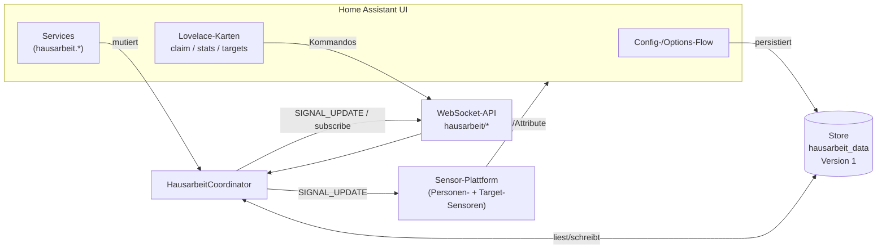
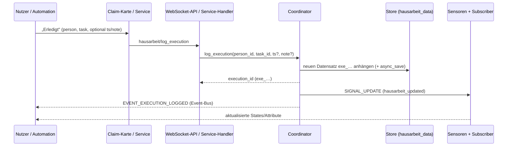

> 🇬🇧 [English](README.md) · 🇩🇪 Deutsch (this page) · 🇪🇸 Español (UI only)

<p align="center">
  
</p>

# Hausarbeit-Tracker

[](https://github.com/hacs/integration)
[](https://github.com/Jo-Highness/hausarbeit/actions/workflows/validate.yml)
[](./LICENSE)
[](https://www.home-assistant.io/)

> Wer hat wann welche Hausarbeit erledigt? Der **Hausarbeit-Tracker** dokumentiert
> jede erledigte Aufgabe pro Person, führt Statistiken und vergleicht **Soll gegen Ist**
> je Periode – komplett lokal, ohne Cloud, UI-First und mit drei mitgelieferten
> Lovelace-Karten.

### 🌍 English / Español

**🇬🇧 English** — *Who did which chore, and when?* The **Hausarbeit-Tracker** logs every
completed chore per person, provides statistics and rankings, and compares **target vs.
actual** per period (day / week / month) — fully local, no cloud, UI-first, with three
bundled Lovelace cards. The user interface ships in German, English and Spanish.
*(The full documentation below is written in German.)*

**🇪🇸 Español** — *¿Quién hizo qué tarea del hogar y cuándo?* El **Hausarbeit-Tracker**
registra cada tarea completada por persona, ofrece estadísticas y clasificaciones, y
compara **objetivo frente a real** por periodo (día / semana / mes) — totalmente local,
sin nube, centrado en la interfaz y con tres tarjetas Lovelace incluidas. La interfaz
está disponible en alemán, inglés y español. *(La documentación completa está en alemán.)*

---

## Inhaltsverzeichnis

- [Funktionsumfang](#funktionsumfang)
- [Screenshots](#screenshots)
- [Installation](#installation)
  - [Über HACS (Custom Repository)](#über-hacs-custom-repository)
  - [Manuelle Installation](#manuelle-installation)
- [Einrichtung](#einrichtung)
  - [Config-Flow](#config-flow-haushalt-anlegen)
  - [Options-Flow](#options-flow-einstellungen--verwaltung)
  - [Aufgaben, Personen & Soll-Vorgaben](#aufgaben-personen--soll-vorgaben)
- [Die drei Lovelace-Karten](#die-drei-lovelace-karten)
- [Architektur & Datenmodell](#architektur--datenmodell)
  - [Komponentenüberblick](#komponentenüberblick)
  - [Datenfluss beim Loggen](#datenfluss-beim-loggen-einer-ausführung)
  - [Store-Schema](#store-schema)
- [Entitäten](#entitäten)
- [Services](#services)
- [Beispiel-Automationen](#beispiel-automationen)
- [Rohdaten & Export](#rohdaten--export)
- [FAQ & Troubleshooting](#faq--troubleshooting)
- [Lizenz](#lizenz)

---

## Funktionsumfang

- ✅ **Aufgaben** frei definieren (Name, Icon, Kategorie, Punkte/Gewicht, aktiv/inaktiv).
- 👤 **Personen** verwalten und optional mit einer bestehenden `person.*`-Entität verknüpfen.
- 📝 **Claimen & Nachtragen**: Erledigungen sofort per Klick loggen oder mit einem
  abweichenden Zeitpunkt und einer Notiz nachtragen.
- 🎯 **Soll/Ist pro Periode** – Vorgaben je Person und Aufgabe für **Tag**, **Woche**
  oder **Monat** (z. B. „Anna: Spülmaschine 3×/Woche"), inkl. Rest, Erfüllungsgrad und
  „on track"-Indikator.
- 📊 **Statistiken & Ranking** – aggregierte Auswertung über einen konfigurierbaren
  Zeitraum (Standard **90 Tage**) mit Aufschlüsselung nach Aufgabe und Zeitfenster
  (heute / 7 / 30 / 90 Tage / gesamt).
- 🗂️ **Rohdaten-Export** – das vollständige Ausführungs-Log ist über die WebSocket-API
  abrufbar und filterbar.
- 🃏 **Drei mitgelieferte Lovelace-Karten**, die von der Integration **automatisch als
  Ressource registriert** werden – keine separate HACS-Frontend-Installation nötig.
- 🖱️ **UI-First**: Vollständige Einrichtung über Config- und Options-Flow, **keine
  YAML-Pflicht**. Services stehen für Automationen dennoch bereit.
- 🔒 **Lokal**: `local_push`, keine externe Kommunikation, Daten liegen im HA-Storage.

---

## Screenshots

> ⚠️ **Platzhalter** – die folgenden Bilder sind noch nicht enthalten. Siehe
> [`images/PLACEHOLDER.md`](./images/PLACEHOLDER.md) für die erwarteten Aufnahmen.

| Erledigung loggen | Statistik & Ranking | Soll/Ist-Fortschritt |
|:---:|:---:|:---:|
|  |  |  |

---

## Installation

### Über HACS (Custom Repository)

Die Integration ist (noch) nicht im HACS-Standardindex enthalten und wird daher als
**benutzerdefiniertes Repository** hinzugefügt:

1. **HACS** in der Seitenleiste öffnen.
2. Zu **Integrationen** wechseln.
3. Oben rechts das **⋮ (3-Punkte-Menü)** → **Benutzerdefinierte Repositories** öffnen.
4. Folgende Werte eintragen:
   - **URL:** `https://github.com/Jo-Highness/hausarbeit`
   - **Kategorie:** `Integration`
5. Auf **Hinzufügen** klicken, das Repository anschließend in der Liste auswählen und
   **installieren**.
6. **Home Assistant neu starten**.
7. Unter **Einstellungen → Geräte & Dienste → Integration hinzufügen** nach
   **„Hausarbeit-Tracker"** suchen und den Config-Flow durchlaufen.

Die Lovelace-Karten werden beim Start der Integration automatisch als Frontend-Ressource
registriert – ein separater HACS-Frontend-Eintrag ist **nicht** erforderlich.

### Manuelle Installation

1. Dieses Repository herunterladen (oder klonen).
2. Den Ordner `custom_components/hausarbeit` in das `custom_components`-Verzeichnis der
   Home-Assistant-Konfiguration kopieren:

   ```text
   <config>/custom_components/hausarbeit/
   ```

3. **Home Assistant neu starten**.
4. Integration wie oben beschrieben hinzufügen.

**Mindestanforderung:** Home Assistant **2024.7.0** oder neuer.

---

## Einrichtung

### Config-Flow (Haushalt anlegen)

Es wird **ein Eintrag pro Haushalt** angelegt. Beim Hinzufügen der Integration wird der
Haushalt initialisiert (Standardtitel „Hausarbeit"). Es sind keine weiteren Pflichtangaben
nötig – Personen, Aufgaben und Soll-Vorgaben werden danach über den Options-Flow oder die
Karten gepflegt.

### Options-Flow (Einstellungen & Verwaltung)

Über **Konfigurieren** am Integrationseintrag stehen zwei globale Einstellungen sowie die
Verwaltung der Stammdaten bereit:

| Option | Schlüssel | Bedeutung | Standard |
|---|---|---|---|
| Wochenstart | `week_start` | Erster Wochentag für die Perioden­berechnung (`0`=Montag … `6`=Sonntag, entspricht Python `weekday()`) | `0` (Montag) |
| Statistik-Zeitraum | `stats_days` | Standard-Zeitraum in Tagen für die Statistik-Aggregation (min. 1, max. 3650) | `90` |

Zusätzlich verwaltet der Options-Flow:

- **Personen** anlegen / ändern / entfernen,
- **Aufgaben** anlegen / ändern / entfernen,
- **Soll-Vorgaben (Targets)** setzen / entfernen.

### Aufgaben, Personen & Soll-Vorgaben

- **Aufgabe** (`task`): Was erledigt wird. Felder: `name`, optional `icon`, `category`,
  `points` (Gewicht, Default `1`) und `active` (Default `true`). Punkte fließen als
  Gewicht in die Statistik ein – so zählt z. B. „Bad putzen" mehr als „Müll rausbringen".
- **Person** (`person`): Wer erledigt. Felder: `name`, optional `icon`, `color` und
  `ha_person_entity` (Verknüpfung zu einer bestehenden `person.*`-Entität).
- **Soll-Vorgabe** (`target`): Wie oft eine Person eine Aufgabe pro Periode erledigen
  soll. Felder: `person_id`, `task_id`, `period` (`day` / `week` / `month`) und `count`
  (Soll-Anzahl).

  > **Beispiel:** „Anna soll die **Spülmaschine 3×/Woche** ausräumen" →
  > `period = week`, `count = 3`, `person_id` = Anna, `task_id` = Spülmaschine.

---

## Die drei Lovelace-Karten

Alle drei Karten werden von der Integration automatisch geladen. Nach der Installation und
einem Neustart können sie direkt im Dashboard verwendet werden. Falls eine Karte im
Editor nicht sofort auftaucht, hilft ein Leeren des Browser-Caches (siehe
[FAQ](#faq--troubleshooting)).

### `hausarbeit-claim-card` – Erledigen & Nachtragen

Buttons zum sofortigen Loggen einer Erledigung sowie zum Nachtragen mit Zeitpunkt/Notiz.

```yaml
type: custom:hausarbeit-claim-card
title: Wer hat's gemacht?      # optional
# persons:                     # optional: Karte auf bestimmte Personen begrenzen
#   - per_ab12cd34
# tasks:                       # optional: Auswahl auf bestimmte Aufgaben begrenzen
#   - tsk_11aa22bb
#   - tsk_33cc44dd
# show_note: true              # optional: Notizfeld einblenden (Default false)
# columns: 3                   # optional: Spaltenanzahl der Aufgaben-Buttons
```

> Nachtragen ist immer möglich (optionales Datum/Zeit-Feld). Ein Undo-Button nimmt
> die zuletzt geloggte Ausführung zurück.

### `hausarbeit-stats-card` – Statistik & Ranking

Zeigt das Ranking der Personen und die Aufschlüsselung nach Aufgabe/Zeitfenster.

```yaml
type: custom:hausarbeit-stats-card
title: Hausarbeits-Ranking     # optional
# days: 30                     # optional: Startzeitraum in Tagen (7 | 30 | 90), umschaltbar
# default_view: ranking        # optional: ranking | tasks
```

### `hausarbeit-targets-card` – Soll/Ist-Fortschritt

Fortschrittsbalken je Soll-Vorgabe für die laufende Periode.

```yaml
type: custom:hausarbeit-targets-card
title: Soll & Ist             # optional
# person: per_ab12cd34        # optional: nur Vorgaben einer Person
# period: week                # optional: day | week | month
```

> ℹ️ **Hinweis:** Die Karten kommunizieren ausschließlich über die integrierte
> WebSocket-API (siehe [Architektur](#architektur--datenmodell)) und benötigen keine
> zusätzliche Konfiguration von Entitäten.

---

## Architektur & Datenmodell

### Komponentenüberblick



Der **Coordinator** ist die zentrale Instanz je Config-Entry
(`hass.data[DOMAIN][entry_id]`). Er kapselt den Zugriff auf den `Store`, benachrichtigt
bei jeder Datenänderung über das Dispatcher-Signal `hausarbeit_updated`
(`SIGNAL_UPDATE`) die Sensoren und die WebSocket-Subscriber und feuert bei jeder neuen
Ausführung das Event `hausarbeit_execution_logged` (`EVENT_EXECUTION_LOGGED`) auf dem
HA-Event-Bus.

### Datenfluss beim Loggen einer Ausführung



### Store-Schema

Persistiert über `homeassistant.helpers.storage.Store` unter dem Schlüssel
`hausarbeit_data`, **STORAGE_VERSION = 1** (Major, mit `async_migrate_func` für künftige
Migrationen; STORAGE_MINOR_VERSION = 1 für vorwärtskompatible Ergänzungen). Das
gespeicherte Dokument hat vier Top-Level-Schlüssel:

```jsonc
{
  "persons": [
    {
      "id": "per_ab12cd34",          // ID-Präfix per_ + 8 Hex
      "name": "Anna",
      "icon": "mdi:account",         // optional
      "color": "#ff8800",            // optional
      "ha_person_entity": "person.anna", // optional, Verknüpfung
      "created": "2026-08-19T08:00:00+00:00" // ISO-8601 UTC
    }
  ],
  "tasks": [
    {
      "id": "tsk_11aa22bb",          // ID-Präfix tsk_
      "name": "Spülmaschine ausräumen",
      "icon": "mdi:dishwasher",      // optional
      "category": "Küche",           // optional
      "points": 1,                    // Gewicht, Default 1
      "active": true,                 // Default true
      "created": "2026-08-19T08:00:00+00:00"
    }
  ],
  "targets": [
    {
      "id": "tgt_55ee66ff",          // ID-Präfix tgt_
      "person_id": "per_ab12cd34",
      "task_id": "tsk_11aa22bb",
      "period": "week",              // day | week | month
      "count": 3                      // Soll-Anzahl pro Periode
    }
  ],
  "executions": [
    {
      "id": "exe_77gg88hh",          // ID-Präfix exe_
      "person_id": "per_ab12cd34",
      "task_id": "tsk_11aa22bb",
      "ts": "2026-08-19T18:30:00+00:00", // ISO-8601 UTC
      "note": "nachgetragen"         // optional
    }
  ]
}
```

**Feld-Referenz** (aus `const.py`):

| Feld | Konstante | Verwendung |
|---|---|---|
| `id` | `F_ID` | eindeutige ID mit Präfix `per_` / `tsk_` / `tgt_` / `exe_` |
| `name` | `F_NAME` | Person / Aufgabe |
| `icon` | `F_ICON` | optionales MDI-Icon |
| `color` | `F_COLOR` | optionale Farbe der Person |
| `ha_person_entity` | `F_HA_PERSON` | optionale Verknüpfung zu `person.*` |
| `created` | `F_CREATED` | ISO-8601 UTC, Anlagezeitpunkt |
| `category` | `F_CATEGORY` | optionale Aufgaben-Kategorie |
| `points` | `F_POINTS` | Gewicht der Aufgabe (Default 1) |
| `active` | `F_ACTIVE` | Aufgabe aktiv? (Default true) |
| `person_id` | `F_PERSON_ID` | Fremdschlüssel in Target/Execution |
| `task_id` | `F_TASK_ID` | Fremdschlüssel in Target/Execution |
| `period` | `F_PERIOD` | `day` / `week` / `month` |
| `count` | `F_COUNT` | Soll-Anzahl je Periode |
| `ts` | `F_TIMESTAMP` | Zeitpunkt der Ausführung (ISO-8601 UTC) |
| `note` | `F_NOTE` | optionale Notiz zur Ausführung |

---

## Entitäten

Alle Entitäten hängen an einem Gerät je Haushalt (Hersteller `hausarbeit`, Modell
`Haushalt`). `unique_id`s werden stabil aus der jeweiligen Datensatz-ID abgeleitet, sodass
Umbenennungen und Anpassungen im UI erhalten bleiben.

### Personen-Sensor (einer je Person)

- **State:** Ausführungen bzw. gewichtete Punkte im Statistik-Zeitraum (`stats_days`,
  Standard 90 Tage).
- **Attribute:**
  - Aufschlüsselung **pro Aufgabe** (wie oft/erledigte Punkte je Aufgabe),
  - Zeitfenster **`today` / `7d` / `30d` / `90d` / `all`** (aus `STAT_WINDOWS_DAYS`;
    `today` = seit lokalem Kalendertag-Beginn, `all` = gesamt).
- `unique_id`: abgeleitet aus der Personen-ID (`per_…`).

### Target-Sensor (einer je Soll-Vorgabe)

- **State:** **Ist**-Anzahl der laufenden Periode.
- **Attribute:**
  - `Soll` (aus `count`),
  - `Rest` (Soll − Ist, min. 0),
  - `Erfüllungsgrad` in % (Ist/Soll),
  - `Periodenstart` / `Periodenende` (unter Berücksichtigung von `week_start`),
  - `on_track` (bool – liegt die Person im Zeitverlauf der Periode im Plan?).
- `unique_id`: abgeleitet aus der Target-ID (`tgt_…`).

### Optional: „Zuletzt erledigt" je Aufgabe

Pro Aufgabe kann ein Sensor bereitstehen, dessen State/Attribute die **letzte Erledigung**
(von wem / wann) anzeigen – nützlich für Dashboards und Automationen wie „X wurde seit
N Tagen nicht mehr gemacht".

---

## Services

Alle Services liegen in der Domain `hausarbeit`. Feldnamen entsprechen exakt den
Konstanten aus `const.py`.

### `hausarbeit.log_execution` – Erledigung loggen

```yaml
service: hausarbeit.log_execution
data:
  person_id: per_ab12cd34
  task_id: tsk_11aa22bb
  # ts: "2026-08-19T18:30:00+00:00"   # optional, sonst „jetzt"
  # note: "vor dem Abendessen"        # optional
```

### `hausarbeit.delete_execution` – Erledigung löschen

```yaml
service: hausarbeit.delete_execution
data:
  execution_id: exe_77gg88hh
```

### `hausarbeit.correct_execution` – Erledigung korrigieren

```yaml
service: hausarbeit.correct_execution
data:
  execution_id: exe_77gg88hh
  # person_id: per_ab12cd34   # optional: neuer Verursacher
  # task_id: tsk_33cc44dd     # optional: andere Aufgabe
  # ts: "2026-08-18T09:00:00+00:00"  # optional: korrigierter Zeitpunkt
  # note: "korrigiert"        # optional
```

### `hausarbeit.add_task` – Aufgabe anlegen

```yaml
service: hausarbeit.add_task
data:
  name: Bad putzen
  # icon: mdi:shower
  # category: Bad
  # points: 3
  # active: true
```

### `hausarbeit.update_task` – Aufgabe ändern

```yaml
service: hausarbeit.update_task
data:
  task_id: tsk_11aa22bb
  # name: Küche wischen
  # icon: mdi:broom
  # category: Küche
  # points: 2
  # active: false
```

### `hausarbeit.remove_task` – Aufgabe entfernen

```yaml
service: hausarbeit.remove_task
data:
  task_id: tsk_11aa22bb
```

### `hausarbeit.add_person` – Person anlegen

```yaml
service: hausarbeit.add_person
data:
  name: Anna
  # icon: mdi:account
  # color: "#ff8800"
  # ha_person_entity: person.anna
```

### `hausarbeit.update_person` – Person ändern

```yaml
service: hausarbeit.update_person
data:
  person_id: per_ab12cd34
  # name: Anna M.
  # icon: mdi:account-heart
  # color: "#3366ff"
  # ha_person_entity: person.anna
```

### `hausarbeit.remove_person` – Person entfernen

```yaml
service: hausarbeit.remove_person
data:
  person_id: per_ab12cd34
```

### `hausarbeit.set_target` – Soll-Vorgabe setzen

```yaml
service: hausarbeit.set_target
data:
  person_id: per_ab12cd34
  task_id: tsk_11aa22bb
  period: week        # day | week | month
  count: 3
```

### `hausarbeit.remove_target` – Soll-Vorgabe entfernen

```yaml
service: hausarbeit.remove_target
data:
  target_id: tgt_55ee66ff
```

---

## Beispiel-Automationen

### 1. Erinnerung, wenn eine Soll-Vorgabe zum Periodenende nicht erfüllt ist

Prüft sonntags um 19:00 einen Target-Sensor: Liegt der Erfüllungsgrad unter 100 % bzw.
ist noch ein Rest offen, wird eine Erinnerung verschickt.

```yaml
alias: Hausarbeit – Wochen-Soll erinnern
trigger:
  - platform: time
    at: "19:00:00"
condition:
  - condition: time
    weekday:
      - sun
  - condition: numeric_state
    entity_id: sensor.hausarbeit_soll_anna_spulmaschine
    attribute: Rest
    above: 0
action:
  - service: notify.mobile_app_anna
    data:
      title: "🧹 Hausarbeit"
      message: >-
        Noch offen diese Woche: {{ state_attr('sensor.hausarbeit_soll_anna_spulmaschine',
        'Rest') }} × Spülmaschine (Erfüllungsgrad
        {{ state_attr('sensor.hausarbeit_soll_anna_spulmaschine', 'Erfüllungsgrad') }} %).
```

### 2. Benachrichtigung, wenn jemand eine Aufgabe loggt

Nutzt das Event `hausarbeit_execution_logged`, das bei jeder neuen Ausführung auf dem
Event-Bus gefeuert wird.

```yaml
alias: Hausarbeit – Erledigung melden
trigger:
  - platform: event
    event_type: hausarbeit_execution_logged
action:
  - service: notify.familie
    data:
      title: "✅ Hausarbeit erledigt"
      message: >-
        {{ trigger.event.data.person_id }} hat {{ trigger.event.data.task_id }} erledigt
        ({{ trigger.event.data.ts }}).
```

> 💡 Alternativ kann statt des Events die **Zustandsänderung** eines Personen-Sensors
> (`state_changed`) als Auslöser dienen.

### 3. Wöchentliches Ranking als Notify

Verschickt montags früh einen kurzen Ranking-Text auf Basis der Personen-Sensoren.

```yaml
alias: Hausarbeit – Wochenranking
trigger:
  - platform: time
    at: "08:00:00"
condition:
  - condition: time
    weekday:
      - mon
action:
  - variables:
      leute:
        - sensor.hausarbeit_anna
        - sensor.hausarbeit_ben
  - service: notify.familie
    data:
      title: "🏆 Hausarbeits-Ranking (letzte 7 Tage)"
      message: >-
        
        {{ state_attr(e, 'friendly_name') }}:
        {{ state_attr(e, '7d') | default(0) }} Punkte
        
```

---

## Rohdaten & Export

Das vollständige Ausführungs-Log ist über die WebSocket-API abrufbar. Die Karten und
eigene Skripte nutzen dafür die folgenden Kommandos:

| WebSocket-Typ | Konstante | Zweck |
|---|---|---|
| `hausarbeit/tasks` | `WS_TASKS` | Liste aller Aufgaben |
| `hausarbeit/persons` | `WS_PERSONS` | Liste aller Personen |
| `hausarbeit/targets` | `WS_TARGETS` | Targets inkl. Ist / Soll / Rest / % |
| `hausarbeit/log` | `WS_LOG` | **Ausführungs-Log (mit Filter/Limit) – Basis für den Export** |
| `hausarbeit/stats` | `WS_STATS` | Aggregierte Statistik (Parameter `days`) |
| `hausarbeit/log_execution` | `WS_LOG_EXECUTION` | Loggt eine Ausführung und liefert die `execution_id` |
| `hausarbeit/delete_execution` | `WS_DELETE_EXECUTION` | Löscht eine Ausführung |
| `hausarbeit/subscribe` | `WS_SUBSCRIBE` | Push bei jeder Datenänderung |

**Beispiel** – Log der letzten Ausführungen über die Entwicklerwerkzeuge (WebSocket)
abrufen:

```json
{ "id": 1, "type": "hausarbeit/log", "limit": 500 }
```

Die zurückgelieferte JSON-Liste enthält je Eintrag `id`, `person_id`, `task_id`, `ts` und
`note` und kann so ohne Umwege exportiert oder weiterverarbeitet werden.

### Einzelne Ausführungen korrigieren oder löschen

Die Claim-Karte bietet einen **Undo-Button** für die zuletzt geloggte Ausführung.
Beliebige vergangene Einträge korrigierst oder löschst du über die HA-Oberfläche unter
**Entwicklerwerkzeuge → Aktionen** mit den Services `hausarbeit.correct_execution`
bzw. `hausarbeit.delete_execution` – die passende `execution_id` findest du über
`hausarbeit/log` (siehe Tabelle oben). Eine dedizierte Log-Verwaltungs-Karte ist für
eine spätere Version geplant.

---

## FAQ & Troubleshooting

**Die Karten erscheinen nicht / „Custom element doesn't exist".**
Die Kartenressourcen werden beim Start der Integration automatisch registriert
(`/hausarbeit_frontend/…`). Nach der Erstinstallation daher einmal **Home Assistant neu
starten** und danach einen **Hard-Reload** des Browsers durchführen (Cache leeren). Prüfen
lässt sich die Registrierung unter **Einstellungen → Dashboards → ⋮ → Ressourcen**.

**Perioden/Statistik „stimmen nicht" – falscher Wochenbeginn oder Zeitzone.**
Perioden werden anhand der **HA-Zeitzone** und der Option **Wochenstart** (`week_start`,
Standard Montag = `0`) berechnet. Zeitstempel (`ts`) werden intern in **UTC** gespeichert
und für Tages-/Wochen-/Monatsgrenzen in die lokale Zeit umgerechnet. Wochenstart im
Options-Flow anpassen, wenn die Woche z. B. sonntags beginnen soll.

**Ein Sensor aktualisiert sich nicht sofort.**
Sensoren werden über das Dispatcher-Signal `hausarbeit_updated` aktualisiert. Bleibt ein
Wert hängen, hilft ein Neuladen der Integration
(**Geräte & Dienste → Hausarbeit-Tracker → ⋮ → Neu laden**). Der Statistik-State bezieht
sich immer auf den konfigurierten Zeitraum `stats_days` (Standard 90 Tage).

**Was passiert bei einem Update / einer Migration?**
Der Store hat `STORAGE_VERSION = 1`. Künftige Schema-Änderungen werden über
`async_migrate_func` automatisch beim Laden migriert; ein manueller Eingriff ist nicht
nötig. Vor größeren Updates empfiehlt sich dennoch ein HA-Backup.

**Kann ich alles nur per YAML/Service betreiben?**
Ja. Der Options-Flow ist bequem, aber sämtliche Stammdaten- und Log-Operationen sind auch
über die [Services](#services) verfügbar (UI-First, aber nicht UI-Pflicht).

---

## Lizenz

Veröffentlicht unter der [MIT-Lizenz](./LICENSE).

---

<sub>Repository: <a href="https://github.com/Jo-Highness/hausarbeit">github.com/Jo-Highness/hausarbeit</a> · Integration „Hausarbeit-Tracker" · lokal &amp; ohne Cloud.</sub>
