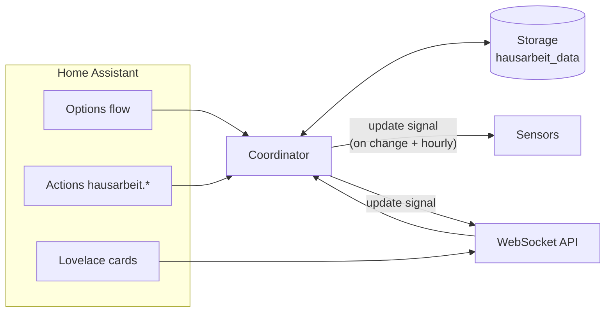

> 🇬🇧 English (this page) · 🇩🇪 [Deutsch](README.de.md) · 🇪🇸 Español (UI only)

<p align="center">
  
</p>

# Hausarbeit-Tracker

[](https://github.com/hacs/integration)
[](https://github.com/Jo-Highness/hausarbeit/actions/workflows/validate.yml)
[](https://github.com/Jo-Highness/hausarbeit/actions/workflows/test.yml)
[](./LICENSE)
[](https://www.home-assistant.io/)

**Track who did which household chore, and when** – with statistics, a ranking and
per-person targets ("Anna: dishwasher 3×/week"), plus three bundled Lovelace cards.
Everything runs locally inside Home Assistant; no cloud, no YAML required.

> 🇪🇸 **Español** — Registra quién hizo qué tarea del hogar y cuándo, con estadísticas,
> clasificación y objetivos por persona. La interfaz de la integración y de las tarjetas
> está disponible en español.

## Quick start

1. **Install** via HACS:
   [](https://my.home-assistant.io/redirect/hacs_repository/?owner=Jo-Highness&repository=hausarbeit&category=integration)
   → **Download**, then **restart Home Assistant**.
2. **Add the integration**: *Settings → Devices & services → Add integration →
   "Hausarbeit-Tracker"* (only a household name is asked).
3. **Create people**: on the integration click **Configure → People → Add person**
   (e.g. "Anna", "Ben").
4. **Create chores**: **Configure → Tasks → Add task** (e.g. "Empty the dishwasher").
5. **Add the card** to a dashboard: *Edit dashboard → Add card → search "Hausarbeit"* and
   pick **"Hausarbeit: Log a chore"** – tap a person, tap a chore, done. Sensors such as
   `sensor.hausarbeit_anna` appear automatically.

Optional: **Configure → Targets** ("Anna should do the dishwasher 3× per week") and the
stats and targets cards.

| Log a chore | Statistics & ranking | Target vs. actual |
|:---:|:---:|:---:|
|  |  |  |

---

## Table of contents

- [Features](#features)
- [Installation](#installation)
- [Configuration](#configuration)
- [Finding IDs (per_… / tsk_… / tgt_…)](#finding-ids)
- [The three Lovelace cards](#the-three-lovelace-cards)
- [Entities](#entities)
- [Actions (services)](#actions-services)
- [Event](#event)
- [Example automations](#example-automations)
- [WebSocket API & raw data](#websocket-api--raw-data)
- [Permissions](#permissions)
- [Architecture & data model](#architecture--data-model)
- [FAQ & troubleshooting](#faq--troubleshooting)
- [Upgrading to 0.2.0](#upgrading-to-020)
- [License](#license)

---

## Features

- ✅ **Chores** with name, icon, category, points/weight and an active flag.
- 👤 **People**, optionally linked to a Home Assistant `person.*` entity and with a color
  for the claim card.
- 📝 **Log & backfill**: one tap logs a chore; optionally with another date/time and a
  note. The claim card can undo the last entry.
- 🎯 **Targets per period** (day / week / month) with actual, remaining, completion rate
  and an "on pace" flag (`im_soll`).
- 📊 **Statistics & ranking** over a configurable period (default 90 days) plus fixed
  windows: today, 7, 30 and 90 days, current month and total.
- 🗂️ **Raw data** via the WebSocket API (e.g. for exports).
- 🃏 **Three Lovelace cards**, delivered and loaded by the integration itself – no
  separate frontend download.
- 🌍 UI in **English, German and Spanish**.
- 🔒 **Local only**: data lives in Home Assistant's storage (`.storage/hausarbeit_data`).

## Installation

### HACS (custom repository)

The integration is not (yet) in the HACS default list, so it is added as a custom
repository:

1. Open **HACS** → **⋮ → Custom repositories**.
2. URL `https://github.com/Jo-Highness/hausarbeit`, type **Integration** → **Add**.
3. Open the repository in HACS → **Download**.
4. **Restart Home Assistant**.
5. *Settings → Devices & services → Add integration →* **Hausarbeit-Tracker**.

Or use the "Open in HACS" button in the [Quick start](#quick-start).

### Manual

Copy `custom_components/hausarbeit` into `<config>/custom_components/`, restart Home
Assistant and add the integration as above.

**Requirements:** Home Assistant **2025.2.0** or newer. Only one household (config
entry) per Home Assistant instance is supported.

## Configuration

Everything is done in the UI: *Settings → Devices & services → Hausarbeit-Tracker →
**Configure***.

| Menu | What you can do |
|---|---|
| **Settings** | **Week start** (first day of a week for weekly targets, default Monday) and **statistics period** in days (1–3650, default 90). |
| **People** | Add / edit / remove. Fields: name, icon, color (CSS color such as `#3f51b5` or `teal`, empty = theme color), linked HA person. |
| **Tasks** | Add / edit / remove. Fields: name, icon, category, points (0–100, default 1), active. Inactive tasks are hidden on the claim card but keep their history. |
| **Targets** | Add or update ("Anna · Dishwasher · week · 3") and remove. The same person + task + period updates the existing target. |

Removing a person or task also removes its targets and sensors; the execution log is
kept. Changing the settings reloads the integration.

| Setup | Integration & entities |
|:---:|:---:|
|  |  |

<a id="finding-ids"></a>

## Finding IDs (per_… / tsk_… / tgt_…)

Actions, card filters and automations use stable IDs instead of names:

| Item | Prefix | Where to find it |
|---|---|---|
| Person | `per_` | attribute `person_id` of the person sensor (e.g. `sensor.hausarbeit_anna`) |
| Task | `tsk_` | attribute `task_id` of the task's "last done" sensor |
| Target | `tgt_` | attribute `target_id` of the target sensor; also `person_id` and `task_id` |
| Execution | `exe_` | response of `hausarbeit.log_execution`, the event `hausarbeit_execution_logged`, or `hausarbeit/log` |

Open *Developer tools → States*, filter for `hausarbeit` and look at the attributes.
The add actions (`add_person`, `add_task`, `set_target`) also return the new ID as a
response.

## The three Lovelace cards

The cards are loaded automatically; after installing and restarting, they appear in the
card picker ("Hausarbeit …"). All options can also be set in the visual card editor.

### `hausarbeit-claim-card` – log a chore

Pick a person, tap a chore. Optional date/time to backfill, optional note, undo for the
last entry.

```yaml
type: custom:hausarbeit-claim-card
title: Who did it?        # optional
persons:                  # optional: only these people
  - per_ab12cd34
tasks:                    # optional: only these tasks
  - tsk_11aa22bb
show_note: true           # optional: show the note field (default false)
columns: 3                # optional: number of task button columns (default 3)
```

### `hausarbeit-stats-card` – statistics & ranking

```yaml
type: custom:hausarbeit-stats-card
title: Chore ranking      # optional
days: 30                  # optional: initial period 7 | 30 | 90 (switchable on the card)
default_view: ranking     # optional: ranking | tasks
```

### `hausarbeit-targets-card` – target vs. actual

```yaml
type: custom:hausarbeit-targets-card
title: Targets            # optional
person: per_ab12cd34      # optional: only this person's targets
period: week              # optional: day | week | month
```

The cards talk to the integration through its WebSocket API and update live; they do
not need any entity configuration.

## Entities

All entities belong to one service device named after your household (default
"Hausarbeit"). Entity IDs below assume that default name.

### Person sensor – one per person

Example: `sensor.hausarbeit_anna`

- **State:** number of chores the person completed within the statistics period
  (`stats_days`, default 90 days). This is a count, not points; the points total is an
  attribute.
- **Unit:** `tasks`
- **Attributes:**

| Attribute | Meaning |
|---|---|
| `person_id` | ID of the person (`per_…`) |
| `stats_days` | statistics period in days |
| `breakdown` | `{task name: count}` within the statistics period |
| `today` | since local midnight |
| `d7`, `d30`, `d90` | last 7 / 30 / 90 days (rolling) |
| `current_month` | since the 1st of the current month |
| `total` | all time |
| `points_total` | sum of task points, all time |

### Target sensor – one per target

Example: `sensor.hausarbeit_anna_dishwasher_week` (name "Anna · Dishwasher (week)").

- **State:** actual count in the current period.
- **Attributes** (names are kept for compatibility with existing automations):

| Attribute | Meaning |
|---|---|
| `target_id`, `person_id`, `task_id` | IDs |
| `soll` | target count per period |
| `ist` | actual count in the current period |
| `rest` | remaining (target − actual, never below 0) |
| `erfuellungsgrad` | completion in % |
| `im_soll` | `true` if the person is on pace for the elapsed part of the period (or done) |
| `periode` | `day`, `week` or `month` |
| `periodenstart`, `periodenende` | current period (local time, end exclusive) |

### "Last done" sensor – one per task

Example: `sensor.hausarbeit_dishwasher_last_done` (diagnostic, timestamp).

- **State:** when the task was last completed (empty if never).
- **Attributes:** `task_id`, `person_id`, `person_name` of the last completion.

### When do the sensors update?

Immediately on every change (logging, editing, removing) **and** every full hour – which
includes local midnight. That keeps "today", the rolling windows, `im_soll` and the
current period correct even if nobody logs anything.

## Actions (services)

All actions are in the `hausarbeit` domain and are described in *Developer tools →
Actions*. Only `log_execution` may be called by every user; all other actions require an
administrator (automations and scripts are always allowed).

| Action | Fields (required **bold**) | Response |
|---|---|---|
| `log_execution` | **person_id**, **task_id**, ts, note | `execution_id` |
| `delete_execution` | **execution_id** | – |
| `correct_execution` | **execution_id**, person_id, task_id, ts, note | – |
| `add_task` | **name**, icon, category, points, active | `id` |
| `update_task` | **task_id**, name, icon, category, points, active | – |
| `remove_task` | **task_id** | – |
| `add_person` | **name**, icon, color, ha_person_entity | `id` |
| `update_person` | **person_id**, name, icon, color, ha_person_entity | – |
| `remove_person` | **person_id** | – |
| `set_target` | **person_id**, **task_id**, **period** (`day`/`week`/`month`), **count** | `target_id` |
| `remove_target` | **target_id** | – |

`ts` without a time zone is interpreted as Home Assistant's local time. In `update_*`
actions, omitted fields stay unchanged; an empty `color` removes the color.

```yaml
action: hausarbeit.log_execution
data:
  person_id: per_ab12cd34
  task_id: tsk_11aa22bb
  ts: "2026-10-15 18:30:00"     # optional, default: now
  note: before dinner           # optional
```

```yaml
action: hausarbeit.set_target
data:
  person_id: per_ab12cd34
  task_id: tsk_11aa22bb
  period: week
  count: 3
```

Using the response in a script:

```yaml
sequence:
  - action: hausarbeit.add_task
    data:
      name: Clean the bathroom
      icon: mdi:shower
      points: 3
    response_variable: task
  - action: persistent_notification.create
    data:
      message: "New task ID: {{ task.id }}"
```

## Event

Every new log entry fires `hausarbeit_execution_logged` with the data `execution_id`,
`person_id`, `person_name`, `task_id`, `task_name` and `ts` (ISO 8601, UTC).

## Example automations

### Reminder on Sunday evening if a weekly target is still open

```yaml
alias: Chores – weekly target reminder
triggers:
  - trigger: time
    at: "19:00:00"
conditions:
  - condition: time
    weekday: sun
  - condition: numeric_state
    entity_id: sensor.hausarbeit_anna_dishwasher_week
    attribute: rest
    above: 0
actions:
  - action: notify.mobile_app_anna
    data:
      title: Chores
      message: >-
        Still open this week:
        {{ state_attr('sensor.hausarbeit_anna_dishwasher_week', 'rest') }} × dishwasher
        ({{ state_attr('sensor.hausarbeit_anna_dishwasher_week', 'erfuellungsgrad') }} % done).
```

### Announce every completed chore

```yaml
alias: Chores – announce completion
triggers:
  - trigger: event
    event_type: hausarbeit_execution_logged
actions:
  - action: notify.family
    data:
      title: Chore done
      message: "{{ trigger.event.data.person_name }} did {{ trigger.event.data.task_name }}."
```

### Weekly ranking on Monday morning

```yaml
alias: Chores – weekly ranking
triggers:
  - trigger: time
    at: "08:00:00"
conditions:
  - condition: time
    weekday: mon
actions:
  - action: notify.family
    data:
      title: Chore ranking (last 7 days)
      message: >-
        
        
        
          
        
        
        {{ loop.index }}. {{ r.name }}: {{ r.count }}
        
```

### Nag if a chore has not been done for 3 days

```yaml
alias: Chores – bathroom overdue
triggers:
  - trigger: time
    at: "18:00:00"
conditions:
  - condition: template
    value_template: >-
      
      {{ last in ['unknown', 'unavailable'] or
         (now() - as_datetime(last)).days >= 3 }}
actions:
  - action: notify.family
    data:
      message: The bathroom has not been cleaned for 3 days.
```

## WebSocket API & raw data

The cards use these commands; you can use them for exports or your own tools.

| Type | Purpose |
|---|---|
| `hausarbeit/persons` | all people |
| `hausarbeit/tasks` | all tasks |
| `hausarbeit/targets` | targets incl. actual / remaining / % / on pace |
| `hausarbeit/log` | execution log, newest first; optional `person_id`, `task_id`, `limit` (1–100000, default 100) |
| `hausarbeit/stats` | ranking, per-task breakdown, time windows; optional `days` |
| `hausarbeit/log_execution` | log an entry (`person_id`, `task_id`, optional `ts`, `note`) |
| `hausarbeit/delete_execution` | delete an entry (`execution_id`) – see [Permissions](#permissions) |
| `hausarbeit/subscribe` | pushes `{"event": "updated"}` on every change |

Example: `{"id": 1, "type": "hausarbeit/log", "limit": 500}` returns `executions`
(each with `id`, `person_id`, `person_name`, `task_id`, `task_name`, `ts`, `note`) and
`total`.

## Permissions

The integration is meant for a family dashboard, so non-admin users can use the cards:

- **Every logged-in user** can read the data, log chores (card or `log_execution`) and
  undo entries **they logged themselves** with the claim card.
- **Administrators** can additionally delete any entry and manage people, tasks and
  targets (options flow and the other actions).
- Automations and scripts are not restricted.

## Architecture & data model



Data is stored in `.storage/hausarbeit_data` (version 1.2):

```jsonc
{
  "persons":    [{ "id": "per_ab12cd34", "name": "Anna", "icon": "mdi:account",
                   "color": "#ff8800", "ha_person_entity": "person.anna",
                   "created": "2026-08-19T08:00:00+00:00" }],
  "tasks":      [{ "id": "tsk_11aa22bb", "name": "Dishwasher", "icon": "mdi:dishwasher",
                   "category": "Kitchen", "points": 1, "active": true,
                   "created": "2026-08-19T08:00:00+00:00" }],
  "targets":    [{ "id": "tgt_55ee66ff", "person_id": "per_ab12cd34",
                   "task_id": "tsk_11aa22bb", "period": "week", "count": 3,
                   "created": "2026-08-19T08:00:00+00:00" }],
  "executions": [{ "id": "exe_77aa88bb", "person_id": "per_ab12cd34",
                   "task_id": "tsk_11aa22bb", "ts": "2026-08-19T18:30:00+00:00",
                   "note": "", "user_id": "…" }]
}
```

Timestamps are stored in UTC; day/week/month boundaries are calculated in Home
Assistant's time zone. `user_id` is only set for entries logged via the cards.
Diagnostics (*Download diagnostics* on the integration) contain counts and IDs only;
names, colors, linked persons and notes are left out.

## FAQ & troubleshooting

**The cards do not show up ("Custom element doesn't exist").**
The integration loads the cards itself (from `/hausarbeit_frontend/…`); they are **not**
listed under *Dashboards → Resources*. Restart Home Assistant once after installing or
updating, then reload the browser without cache (or clear the app cache on mobile).

**Weekly targets start on the wrong day / periods look shifted.**
Set the **week start** under *Configure → Settings* and check Home Assistant's time zone
(*Settings → System → General*).

**Why does the person sensor show fewer chores than "total"?**
The state only counts the statistics period (`stats_days`); `total` counts everything.

**What happens to my data on updates?**
It is migrated automatically. 0.2.0 normalizes stored timestamps to UTC (same points in
time). A Home Assistant backup before updating is always a good idea.

**What happens if I remove the integration?**
All people, tasks, targets and the log are deleted together with the integration.

**Can I use it without the UI?**
Yes – everything except the settings is also available as [actions](#actions-services).

## Upgrading to 0.2.0

- Minimum Home Assistant version is now **2025.2.0**.
- Existing entity IDs stay the same. Sensors created **after** the update get English
  name-based IDs, e.g. `sensor.hausarbeit_dishwasher_last_done` instead of
  `…_zuletzt_erledigt` (display names still follow your language).
- The unit of the person and target sensors is now `tasks` (was `Aufgaben`). If Home
  Assistant reports a changed statistics unit (*Developer tools → Statistics*), choose to
  update the unit – the values are the same counts.
- Sensors of people/tasks/targets that were removed earlier are cleaned up from the
  entity registry.
- All actions except `log_execution` now require an administrator when called by a user
  (automations are unaffected). Non-admins can still log chores and undo their own
  entries on the claim card.
- Removing the integration now deletes its stored data.

## License

[MIT](./LICENSE)
