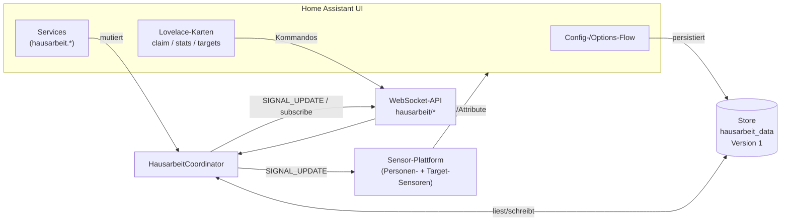
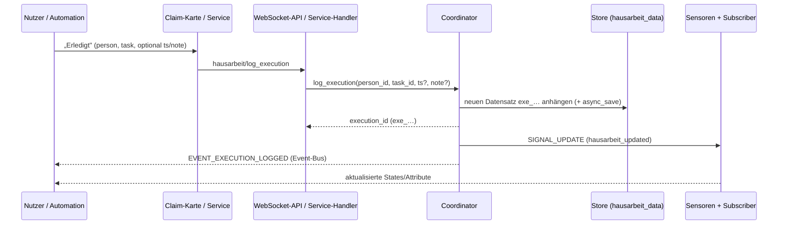

> 🇬🇧 English (this page) · 🇩🇪 [Deutsch](README.de.md) · 🇪🇸 Español (UI only)

<p align="center">
  
</p>

# Hausarbeit-Tracker

[](https://github.com/hacs/integration)
[](https://github.com/Jo-Highness/hausarbeit/actions/workflows/validate.yml)
[](./LICENSE)
[](https://www.home-assistant.io/)

> Who did which chore, and when? The **Hausarbeit-Tracker** documents
> every completed task per person, keeps statistics and compares **target vs. actual**
> per period – fully local, no cloud, UI-first and with three bundled
> Lovelace cards.

### 🌍 English / Español

**🇬🇧 English** — *Who did which chore, and when?* The **Hausarbeit-Tracker** logs every
completed chore per person, provides statistics and rankings, and compares **target vs.
actual** per period (day / week / month) — fully local, no cloud, UI-first, with three
bundled Lovelace cards. The user interface ships in German, English and Spanish.

**🇪🇸 Español** — *¿Quién hizo qué tarea del hogar y cuándo?* El **Hausarbeit-Tracker**
registra cada tarea completada por persona, ofrece estadísticas y clasificaciones, y
compara **objetivo frente a real** por periodo (día / semana / mes) — totalmente local,
sin nube, centrado en la interfaz y con tres tarjetas Lovelace incluidas. La interfaz
está disponible en alemán, inglés y español. *(La interfaz de usuario está disponible en español.)*

---

## Table of Contents

- [Features](#features)
- [Screenshots](#screenshots)
- [Installation](#installation)
  - [Via HACS (Custom Repository)](#via-hacs-custom-repository)
  - [Manual Installation](#manual-installation)
- [Setup](#setup)
  - [Config Flow](#config-flow-create-a-household)
  - [Options Flow](#options-flow-settings--management)
  - [Tasks, Persons & Targets](#tasks-persons--targets)
- [The Three Lovelace Cards](#the-three-lovelace-cards)
- [Architecture & Data Model](#architecture--data-model)
  - [Component Overview](#component-overview)
  - [Data Flow When Logging](#data-flow-when-logging-an-execution)
  - [Store Schema](#store-schema)
- [Entities](#entities)
- [Services](#services)
- [Example Automations](#example-automations)
- [Raw Data & Export](#raw-data--export)
- [FAQ & Troubleshooting](#faq--troubleshooting)
- [License](#license)

---

## Features

- ✅ **Tasks** freely definable (name, icon, category, points/weight, active/inactive).
- 👤 **Persons** management, optionally linked to an existing `person.*` entity.
- 📝 **Claim & backfill**: log completions instantly with a click, or backfill them with
  a different timestamp and a note.
- 🎯 **Target/actual per period** – targets per person and task for **day**, **week**
  or **month** (e.g. "Anna: dishwasher 3×/week"), including remaining, completion rate and
  an "on track" indicator.
- 📊 **Statistics & ranking** – aggregated evaluation over a configurable
  time range (default **90 days**) with a breakdown by task and time window
  (today / 7 / 30 / 90 days / total).
- 🗂️ **Raw data export** – the complete execution log is available via the WebSocket API
  and can be filtered.
- 🃏 **Three bundled Lovelace cards** that are **automatically registered as a resource**
  by the integration – no separate HACS frontend installation required.
- 🖱️ **UI-first**: complete setup via config and options flow, **no YAML required**.
  Services are nevertheless available for automations.
- 🔒 **Local**: `local_push`, no external communication, data lives in HA storage.

---

## Screenshots

> Captured from a demo Home Assistant with fictional data.

**The three bundled Lovelace cards**

| Log a chore | Statistics & ranking | Target vs. actual |
|:---:|:---:|:---:|
|  |  |  |

**Setup & entities**

| Setup (config flow) | Integration & entities |
|:---:|:---:|
|  |  |

---

## Installation

### Via HACS (Custom Repository)

[](https://my.home-assistant.io/redirect/hacs_repository/?owner=Jo-Highness&repository=hausarbeit&category=integration)

Click the button above to open this repository directly in HACS, or add it manually — the
integration is not (yet) part of the HACS default index and is therefore added as a
**custom repository**:

1. Open **HACS** in the sidebar.
2. Switch to **Integrations**.
3. Open the **⋮ (3-dot menu)** in the top right → **Custom repositories**.
4. Enter the following values:
   - **URL:** `https://github.com/Jo-Highness/hausarbeit`
   - **Category:** `Integration`
5. Click **Add**, then select the repository in the list and
   **install** it.
6. **Restart Home Assistant**.
7. Under **Settings → Devices & Services → Add Integration**, search for
   **"Hausarbeit-Tracker"** and run through the config flow.

The Lovelace cards are automatically registered as a frontend resource when the integration
starts – a separate HACS frontend entry is **not** required.

### Manual Installation

1. Download (or clone) this repository.
2. Copy the folder `custom_components/hausarbeit` into the `custom_components` directory of
   your Home Assistant configuration:

   ```text
   <config>/custom_components/hausarbeit/
   ```

3. **Restart Home Assistant**.
4. Add the integration as described above.

**Minimum requirement:** Home Assistant **2024.7.0** or newer.

---

## Setup

### Config Flow (create a household)

**One entry per household** is created. When the integration is added, the household is
initialized (default title "Hausarbeit"). No further mandatory input is required – persons,
tasks and targets are managed afterwards via the options flow or the cards.

### Options Flow (settings & management)

Via **Configure** on the integration entry, two global settings as well as the management
of the master data are available:

| Option | Key | Meaning | Default |
|---|---|---|---|
| Week start | `week_start` | First weekday for period calculation (`0`=Monday … `6`=Sunday, matches Python `weekday()`) | `0` (Monday) |
| Statistics period | `stats_days` | Default period in days for the statistics aggregation (min. 1, max. 3650) | `90` |

In addition, the options flow manages:

- **Persons** create / edit / remove,
- **Tasks** create / edit / remove,
- **Targets** set / remove.

### Tasks, Persons & Targets

- **Task** (`task`): What gets done. Fields: `name`, optional `icon`, `category`,
  `points` (weight, default `1`) and `active` (default `true`). Points are factored in as
  weight in the statistics – so e.g. "clean the bathroom" counts more than "take out the trash".
- **Person** (`person`): Who does it. Fields: `name`, optional `icon`, `color` and
  `ha_person_entity` (link to an existing `person.*` entity).
- **Target** (`target`): How often a person should complete a task per period.
  Fields: `person_id`, `task_id`, `period` (`day` / `week` / `month`) and `count`
  (target count).

  > **Example:** "Anna should empty the **dishwasher 3×/week**" →
  > `period = week`, `count = 3`, `person_id` = Anna, `task_id` = dishwasher.

---

## The Three Lovelace Cards

All three cards are loaded automatically by the integration. After installation and a
restart they can be used directly in the dashboard. If a card does not appear immediately in
the editor, clearing the browser cache helps (see
[FAQ](#faq--troubleshooting)).

### `hausarbeit-claim-card` – Complete & backfill

Buttons for logging a completion instantly as well as for backfilling with timestamp/note.

```yaml
type: custom:hausarbeit-claim-card
title: Wer hat's gemacht?      # optional
# persons:                     # optional: Karte auf bestimmte Personen begrenzen
#   - per_ab12cd34
# tasks:                       # optional: Auswahl auf bestimmte Aufgaben begrenzen
#   - tsk_11aa22bb
#   - tsk_33cc44dd
# show_note: true              # optional: Notizfeld einblenden (Default false)
# columns: 3                   # optional: Spaltenanzahl der Aufgaben-Buttons
```

> Backfilling is always possible (optional date/time field). An undo button reverts
> the most recently logged execution.

### `hausarbeit-stats-card` – Statistics & ranking

Shows the ranking of the persons and the breakdown by task/time window.

```yaml
type: custom:hausarbeit-stats-card
title: Hausarbeits-Ranking     # optional
# days: 30                     # optional: Startzeitraum in Tagen (7 | 30 | 90), umschaltbar
# default_view: ranking        # optional: ranking | tasks
```

### `hausarbeit-targets-card` – Target/actual progress

Progress bar per target for the current period.

```yaml
type: custom:hausarbeit-targets-card
title: Soll & Ist             # optional
# person: per_ab12cd34        # optional: nur Vorgaben einer Person
# period: week                # optional: day | week | month
```

> ℹ️ **Note:** The cards communicate exclusively via the built-in
> WebSocket API (see [Architecture](#architecture--data-model)) and require no
> additional configuration of entities.

---

## Architecture & Data Model

### Component Overview



The **coordinator** is the central instance per config entry
(`hass.data[DOMAIN][entry_id]`). It encapsulates access to the `Store`, notifies
the sensors and the WebSocket subscribers on every data change via the dispatcher signal
`hausarbeit_updated` (`SIGNAL_UPDATE`), and fires the event
`hausarbeit_execution_logged` (`EVENT_EXECUTION_LOGGED`) on the HA event bus on every new
execution.

### Data Flow When Logging an Execution



### Store Schema

Persisted via `homeassistant.helpers.storage.Store` under the key
`hausarbeit_data`, **STORAGE_VERSION = 1** (major, with `async_migrate_func` for future
migrations; STORAGE_MINOR_VERSION = 1 for forward-compatible additions). The
stored document has four top-level keys:

```jsonc
{
  "persons": [
    {
      "id": "per_ab12cd34",          // ID-Präfix per_ + 8 Hex
      "name": "Anna",
      "icon": "mdi:account",         // optional
      "color": "#ff8800",            // optional
      "ha_person_entity": "person.anna", // optional, Verknüpfung
      "created": "2026-08-19T08:00:00+00:00" // ISO-8601 UTC
    }
  ],
  "tasks": [
    {
      "id": "tsk_11aa22bb",          // ID-Präfix tsk_
      "name": "Spülmaschine ausräumen",
      "icon": "mdi:dishwasher",      // optional
      "category": "Küche",           // optional
      "points": 1,                    // Gewicht, Default 1
      "active": true,                 // Default true
      "created": "2026-08-19T08:00:00+00:00"
    }
  ],
  "targets": [
    {
      "id": "tgt_55ee66ff",          // ID-Präfix tgt_
      "person_id": "per_ab12cd34",
      "task_id": "tsk_11aa22bb",
      "period": "week",              // day | week | month
      "count": 3                      // Soll-Anzahl pro Periode
    }
  ],
  "executions": [
    {
      "id": "exe_77gg88hh",          // ID-Präfix exe_
      "person_id": "per_ab12cd34",
      "task_id": "tsk_11aa22bb",
      "ts": "2026-08-19T18:30:00+00:00", // ISO-8601 UTC
      "note": "nachgetragen"         // optional
    }
  ]
}
```

**Field reference** (from `const.py`):

| Field | Constant | Usage |
|---|---|---|
| `id` | `F_ID` | unique ID with prefix `per_` / `tsk_` / `tgt_` / `exe_` |
| `name` | `F_NAME` | person / task |
| `icon` | `F_ICON` | optional MDI icon |
| `color` | `F_COLOR` | optional color of the person |
| `ha_person_entity` | `F_HA_PERSON` | optional link to `person.*` |
| `created` | `F_CREATED` | ISO-8601 UTC, creation timestamp |
| `category` | `F_CATEGORY` | optional task category |
| `points` | `F_POINTS` | weight of the task (default 1) |
| `active` | `F_ACTIVE` | task active? (default true) |
| `person_id` | `F_PERSON_ID` | foreign key in target/execution |
| `task_id` | `F_TASK_ID` | foreign key in target/execution |
| `period` | `F_PERIOD` | `day` / `week` / `month` |
| `count` | `F_COUNT` | target count per period |
| `ts` | `F_TIMESTAMP` | timestamp of the execution (ISO-8601 UTC) |
| `note` | `F_NOTE` | optional note for the execution |

---

## Entities

All entities are attached to one device per household (manufacturer `hausarbeit`, model
`Haushalt`). `unique_id`s are derived stably from the respective record ID, so that
renames and adjustments in the UI are preserved.

### Person sensor (one per person)

- **State:** executions or weighted points within the statistics period (`stats_days`,
  default 90 days).
- **Attributes:**
  - breakdown **per task** (how often/completed points per task),
  - time windows **`today` / `7d` / `30d` / `90d` / `all`** (from `STAT_WINDOWS_DAYS`;
    `today` = since the start of the local calendar day, `all` = total).
- `unique_id`: derived from the person ID (`per_…`).

### Target sensor (one per target)

- **State:** **actual** count of the current period.
- **Attributes:**
  - `Soll` (from `count`),
  - `Rest` (target − actual, min. 0),
  - `Erfüllungsgrad` in % (actual/target),
  - `Periodenstart` / `Periodenende` (taking `week_start` into account),
  - `on_track` (bool – is the person on plan for the elapsed portion of the period?).
- `unique_id`: derived from the target ID (`tgt_…`).

### Optional: "Last completed" per task

Per task, a sensor can be available whose state/attributes show the **last completion**
(by whom / when) – useful for dashboards and automations like "X has not been done for
N days".

---

## Services

All services live in the domain `hausarbeit`. Field names exactly match the
constants from `const.py`.

### `hausarbeit.log_execution` – log a completion

```yaml
service: hausarbeit.log_execution
data:
  person_id: per_ab12cd34
  task_id: tsk_11aa22bb
  # ts: "2026-08-19T18:30:00+00:00"   # optional, sonst „jetzt"
  # note: "vor dem Abendessen"        # optional
```

### `hausarbeit.delete_execution` – delete a completion

```yaml
service: hausarbeit.delete_execution
data:
  execution_id: exe_77gg88hh
```

### `hausarbeit.correct_execution` – correct a completion

```yaml
service: hausarbeit.correct_execution
data:
  execution_id: exe_77gg88hh
  # person_id: per_ab12cd34   # optional: neuer Verursacher
  # task_id: tsk_33cc44dd     # optional: andere Aufgabe
  # ts: "2026-08-18T09:00:00+00:00"  # optional: korrigierter Zeitpunkt
  # note: "korrigiert"        # optional
```

### `hausarbeit.add_task` – create a task

```yaml
service: hausarbeit.add_task
data:
  name: Bad putzen
  # icon: mdi:shower
  # category: Bad
  # points: 3
  # active: true
```

### `hausarbeit.update_task` – edit a task

```yaml
service: hausarbeit.update_task
data:
  task_id: tsk_11aa22bb
  # name: Küche wischen
  # icon: mdi:broom
  # category: Küche
  # points: 2
  # active: false
```

### `hausarbeit.remove_task` – remove a task

```yaml
service: hausarbeit.remove_task
data:
  task_id: tsk_11aa22bb
```

### `hausarbeit.add_person` – create a person

```yaml
service: hausarbeit.add_person
data:
  name: Anna
  # icon: mdi:account
  # color: "#ff8800"
  # ha_person_entity: person.anna
```

### `hausarbeit.update_person` – edit a person

```yaml
service: hausarbeit.update_person
data:
  person_id: per_ab12cd34
  # name: Anna M.
  # icon: mdi:account-heart
  # color: "#3366ff"
  # ha_person_entity: person.anna
```

### `hausarbeit.remove_person` – remove a person

```yaml
service: hausarbeit.remove_person
data:
  person_id: per_ab12cd34
```

### `hausarbeit.set_target` – set a target

```yaml
service: hausarbeit.set_target
data:
  person_id: per_ab12cd34
  task_id: tsk_11aa22bb
  period: week        # day | week | month
  count: 3
```

### `hausarbeit.remove_target` – remove a target

```yaml
service: hausarbeit.remove_target
data:
  target_id: tgt_55ee66ff
```

---

## Example Automations

### 1. Reminder when a target is not met by the end of the period

Checks a target sensor on Sundays at 19:00: if the completion rate is below 100 % or
there is still a remaining amount, a reminder is sent.

```yaml
alias: Hausarbeit – Wochen-Soll erinnern
trigger:
  - platform: time
    at: "19:00:00"
condition:
  - condition: time
    weekday:
      - sun
  - condition: numeric_state
    entity_id: sensor.hausarbeit_soll_anna_spulmaschine
    attribute: Rest
    above: 0
action:
  - service: notify.mobile_app_anna
    data:
      title: "🧹 Hausarbeit"
      message: >-
        Noch offen diese Woche: {{ state_attr('sensor.hausarbeit_soll_anna_spulmaschine',
        'Rest') }} × Spülmaschine (Erfüllungsgrad
        {{ state_attr('sensor.hausarbeit_soll_anna_spulmaschine', 'Erfüllungsgrad') }} %).
```

### 2. Notification when someone logs a task

Uses the event `hausarbeit_execution_logged`, which is fired on the event bus on every new
execution.

```yaml
alias: Hausarbeit – Erledigung melden
trigger:
  - platform: event
    event_type: hausarbeit_execution_logged
action:
  - service: notify.familie
    data:
      title: "✅ Hausarbeit erledigt"
      message: >-
        {{ trigger.event.data.person_id }} hat {{ trigger.event.data.task_id }} erledigt
        ({{ trigger.event.data.ts }}).
```

> 💡 Alternatively, instead of the event, the **state change** of a person sensor
> (`state_changed`) can serve as the trigger.

### 3. Weekly ranking as a notification

Sends a short ranking text on Monday mornings based on the person sensors.

```yaml
alias: Hausarbeit – Wochenranking
trigger:
  - platform: time
    at: "08:00:00"
condition:
  - condition: time
    weekday:
      - mon
action:
  - variables:
      leute:
        - sensor.hausarbeit_anna
        - sensor.hausarbeit_ben
  - service: notify.familie
    data:
      title: "🏆 Hausarbeits-Ranking (letzte 7 Tage)"
      message: >-
        
        {{ state_attr(e, 'friendly_name') }}:
        {{ state_attr(e, '7d') | default(0) }} Punkte
        
```

---

## Raw Data & Export

The complete execution log is available via the WebSocket API. The cards and
your own scripts use the following commands for this:

| WebSocket type | Constant | Purpose |
|---|---|---|
| `hausarbeit/tasks` | `WS_TASKS` | list of all tasks |
| `hausarbeit/persons` | `WS_PERSONS` | list of all persons |
| `hausarbeit/targets` | `WS_TARGETS` | targets incl. actual / target / remaining / % |
| `hausarbeit/log` | `WS_LOG` | **execution log (with filter/limit) – basis for the export** |
| `hausarbeit/stats` | `WS_STATS` | aggregated statistics (parameter `days`) |
| `hausarbeit/log_execution` | `WS_LOG_EXECUTION` | logs an execution and returns the `execution_id` |
| `hausarbeit/delete_execution` | `WS_DELETE_EXECUTION` | deletes an execution |
| `hausarbeit/subscribe` | `WS_SUBSCRIBE` | push on every data change |

**Example** – retrieve the log of the last executions via the developer tools (WebSocket):

```json
{ "id": 1, "type": "hausarbeit/log", "limit": 500 }
```

The returned JSON list contains `id`, `person_id`, `task_id`, `ts` and
`note` per entry and can thus be exported or processed further without detours.

### Correcting or deleting individual executions

The claim card provides an **undo button** for the most recently logged execution.
You can correct or delete any past entries via the HA interface under
**Developer Tools → Actions** using the services `hausarbeit.correct_execution`
or `hausarbeit.delete_execution` – you find the matching `execution_id` via
`hausarbeit/log` (see the table above). A dedicated log management card is planned for
a later version.

---

## FAQ & Troubleshooting

**The cards do not appear / "Custom element doesn't exist".**
The card resources are automatically registered when the integration starts
(`/hausarbeit_frontend/…`). After the initial installation, therefore **restart Home
Assistant** once and then perform a **hard reload** of the browser (clear the cache). The
registration can be checked under **Settings → Dashboards → ⋮ → Resources**.

**Periods/statistics are "wrong" – incorrect week start or time zone.**
Periods are calculated based on the **HA time zone** and the **week start** option
(`week_start`, default Monday = `0`). Timestamps (`ts`) are stored internally in **UTC**
and converted to local time for day/week/month boundaries. Adjust the week start in the
options flow if the week should begin on Sunday, for example.

**A sensor does not update immediately.**
Sensors are updated via the dispatcher signal `hausarbeit_updated`. If a
value gets stuck, reloading the integration helps
(**Devices & Services → Hausarbeit-Tracker → ⋮ → Reload**). The statistics state always
refers to the configured period `stats_days` (default 90 days).

**What happens during an update / a migration?**
The store has `STORAGE_VERSION = 1`. Future schema changes are migrated automatically on
load via `async_migrate_func`; manual intervention is not needed. Before larger updates,
an HA backup is nevertheless recommended.

**Can I run everything only via YAML/service?**
Yes. The options flow is convenient, but all master data and log operations are also
available via the [Services](#services) (UI-first, but not UI-mandatory).

---

## License

Released under the [MIT License](./LICENSE).

---

<sub>Repository: <a href="https://github.com/Jo-Highness/hausarbeit">github.com/Jo-Highness/hausarbeit</a> · Integration "Hausarbeit-Tracker" · local &amp; without cloud.</sub>
